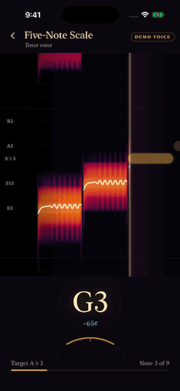
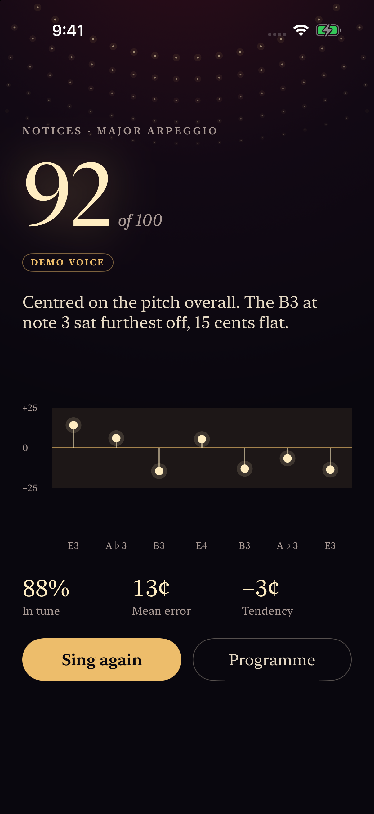
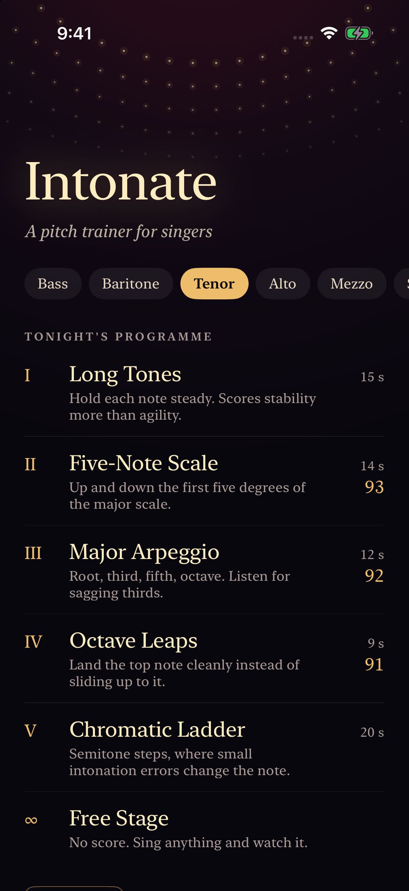
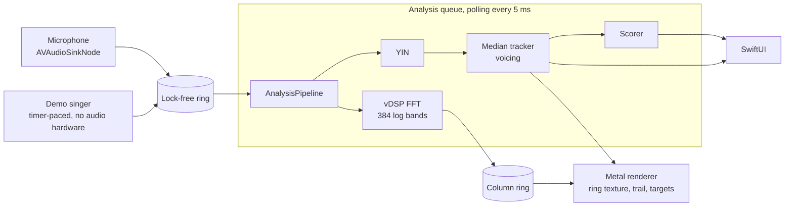
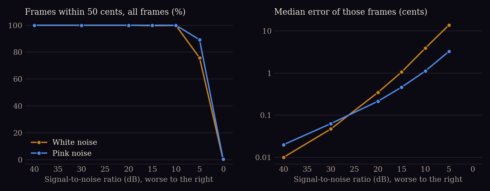

# Intonate

[](https://github.com/matejpopovski/Intonate/actions/workflows/ci.yml)

An iOS pitch trainer for singers. It listens through AVAudioEngine, finds the pitch with a hand-written YIN detector, draws a live spectrogram in Metal, and scores you note by note against an exercise.

<p align="center">
  
  
  
</p>

These images are the app running in the iOS Simulator in **demo mode**: a synthesized voice feeds the real pipeline, because the Simulator has no microphone worth trusting. Nobody has sung into this build, and it has not been run on a phone. What has been measured is the detector, on 40 recorded excerpts of solo singing and on synthesized signals with exact ground truth.

| Pitch tracking, frame by frame | Result |
| --- | --- |
| Recorded singers it was not tuned on: frames within 50 cents | **93.1%**, unvoiced decisions counted as misses |
| Same frames: octave errors | **2.2%** of sung frames |
| Same recordings: unvoiced frames wrongly given a pitch | **11.2%** |
| Synthesized voices, C2 to C6, clean: mean error | **under 0.3 cents**, no octave errors in 41,400 frames |
| Synthesized /a/ vowel at 10 dB SNR, white noise: median error | **3.9 cents** |
| Note change to a settled reading, in audio time | **39 to 48 ms** median, 54 ms worst |

The recorded figures are the ones to believe. A synthesized tone is perfectly periodic and a singer is not, so the clean number describes the arithmetic and says little about a voice.

## Why a voice is a hard signal

A tuner for a guitar string has it easy. A voice moves, and it does so inside a very small tolerance: 25 cents is a quarter of a semitone, or about 1.5% in frequency. At the top of the range, one sample of lag at 44.1 kHz is already about 40 cents, so the period has to be found to a fraction of a sample.

The larger trap is the octave. A sung vowel can have more energy in its second or fourth harmonic than in its fundamental. Take the loudest spectral peak and you report the formant. A periodic signal also repeats at 2T and 3T, so a correlation peak there looks as good as the one at T. A display that sometimes jumps an octave is worse than one that is a little slow, because it tells a singer they are wrong when they are right.

Then there is time. The analysis window must span a full period of the lowest note, and a longer window is steadier, but every sample of window is delay between the voice and the screen.

## What was built, and what was rejected

**YIN, written by hand, over the obvious alternatives.** Each row below adds one step of the algorithm, on the same seeded clips of 49 notes. "Within 50 cents" counts all 6,272 frames.

| Detector | Within 50 cents, /a/ vowel | Octave errors | Same, 5 dB SNR | Fundamental 20 dB down: octave errors |
| --- | --- | --- | --- | --- |
| Strongest spectral peak | 83.3% | 11.7% | 83.6% | **85.5%** |
| Autocorrelation peak | 46.3% | 23.3% | 41.9% | 22.4% |
| YIN steps 2 and 3, deepest dip | 50.1% | 21.9% | 40.6% | 21.7% |
| Plus absolute threshold, step 4 | 100% | 0 | 40.6% | 0 |
| Plus parabola, step 5 | 100% | 0 | 40.6% | 0 |
| Plus first dip near the deepest (shipped) | 100% | 0 | **81.4%** | 0 |

Steps 1 to 3 look worse here than on natural audio. The test signals are exactly periodic, so the dips at T, 2T and 3T tie and the choice among them is close to arbitrary. The parabola adds no accuracy to this column but takes the mean error from 3.6 to 0.003 cents.

The last row is a departure from the paper. When no dip crosses the threshold, YIN takes the deepest dip, and at low SNR that is usually a subharmonic. Taking the first dip within 0.1 of the deepest removed the octave errors at 5 dB in this table, though 18.7% of those frames are still gross errors, and with no voicing gate in this table the plain spectral peak is level with it there. On recordings the change added 0.16 points of overall accuracy, a small gain in the same direction.

**Two thresholds, not one.** The paper's threshold both picks the lag and implies voicing. Here the detector keeps its 0.15 for picking a lag, where low values avoid octave errors, and the tracker has a separate 0.3 for deciding that anyone is singing. These came from a grid search on half of the vocadito singers, described below. The top of that grid is flat, so the exact values matter less than keeping them separate.

**FFT difference function.** YIN's step 2 is usually written as two nested loops. Both forms are here, a test holds them equal, and the transform wins on measured time at this window size: 26.8 µs against 43.1 µs per frame, on one M3 Max core. Double precision in the transform is deliberate, since the dip for a clean tone is tiny next to the frame energy.

**A 23 ms window.** Measured, not assumed. Shorter is faster but loses accuracy on real singing; longer is steadier but later.

| Window W | Note change, median | 20 dB SNR, mean error | Recordings: overall accuracy | Recordings: within 25 cents |
| --- | --- | --- | --- | --- |
| 512 (11.6 ms) | 34.8 ms | 0.86 cents | 92.3% | 92.1% |
| 768 (17.4 ms) | 39.1 ms | 0.68 cents | 92.7% | 93.2% |
| **1024 (23.2 ms)** | **43.5 ms** | **0.59 cents** | **93.1%** | **93.5%** |
| 2048 (46.4 ms) | 64.4 ms | 0.39 cents | 93.0% | 91.9% |

The recording columns are the tuning singers. On those, 2048 samples is worse within 25 cents even though it is steadier in noise, probably because a window that long averages over real pitch movement.

**`AVAudioSinkNode`, not `installTap`.** A tap hands over large buffers on a secondary thread, which is the wrong place to start when latency matters. The sink runs on the audio I/O thread at the hardware buffer size. Its block only copies into a lock-free single-producer, single-consumer ring, built on a small C shim because Swift's `Synchronization` module needs iOS 18 and this targets iOS 17.

**A ring texture for the waterfall.** History is one 384 by 1024 texture. A new analysis column overwrites the oldest row, and the fragment shader offsets its lookup by a head position, so scrolling costs a uniform. The texture is private and filled by blits from a shared buffer, which works the same in the Simulator as on a device. Colour ramps from black through velvet and crimson to brass, the notes ahead wait to the right of the now line, and the pitch trail is warm while in tune and turns blue as it drifts.

**Shaders compiled at run time.** Xcode 26 and later install the Metal toolchain as an optional component. It was missing on the machine this was built on, and a clean CI runner may lack it too, so `Waterfall.msl` ships as a resource and compiles on first use. This costs 1.3 s on a freshly created simulator, spent before the audio starts. Shader mistakes surface in the renderer tests and not in the build log, and a test compares the Swift and shader struct layouts through pipeline reflection, since no shared header ties them together.

## How audio moves through it



`AnalysisPipeline` holds no clock and counts only samples, so output does not depend on callback size (a test feeds it in chunks from 1 to 4,800 samples and requires identical frames). The same object runs under the app, the tests and the benchmarks, which is what lets a measured number describe the app. The package `IntonateCore` needs no device: it holds the detector, the synthesizer, the scorer and `intonate-bench`.

The demo singer is a scripted performance with a scoop into each note, delayed vibrato, a slightly flat habit and a noise floor. It writes into the same ring as the microphone. Only the source of the samples is synthetic; everything after that point is the code a singer would be measured by.

## Results

All of this reproduces from a clean clone. The accuracy and latency figures are seeded and do not depend on the machine; timing ran on an Apple M3 Max with 36 GB.

```sh
swift run -c release --package-path Packages/IntonateCore intonate-bench all   # about a minute
scripts/fetch-vocadito.sh                                                      # 58 MB, not committed
swift run -c release --package-path Packages/IntonateCore intonate-bench vocadito data/vocadito
scripts/measure-simulator.sh                                                   # simulator timing
uv run --script scripts/plot_results.py                                        # the figure below
```

### Recorded singing

[vocadito](https://zenodo.org/records/5578807) (Bittner et al., 2021, CC BY 4.0) is 40 short excerpts of solo singing by 29 singers of varied training, in seven languages, recorded on assorted devices. It is downloaded and not redistributed here. Each file ran through the same pipeline as the app, offline, from WAV. Singers were split alternately into a tuning set and a held-out set, so no voice is on both sides, and the thresholds, window and median length were chosen from the tuning set alone.

| | Tuning singers (22 tracks) | **Held out (18 tracks)** |
| --- | --- | --- |
| Voiced reference frames | 49,396 | 43,570 |
| Within 50 cents, unvoiced counted as a miss | 95.0% | **93.1%** |
| Within 25 cents, same | 93.5% | **91.5%** |
| Octave-folded, within 50 cents | 96.0% | **95.2%** |
| Voicing recall | 96.7% | **96.4%** |
| Voicing false alarm | 10.3% | **11.2%** |
| Overall accuracy | 93.1% | **91.7%** |
| Octave errors, share of voiced frames | 1.0% | **2.2%** |

Those figures count a frame the tracker withholds as wrong, which is stricter than the usual raw pitch accuracy. With the tracker out of the way, bare YIN gets 96.8% within 50 cents and 98.5% octave-folded over all 40 tracks, at the cost of a pitch on 54% of unvoiced frames. The gap between tuning and held-out is real and about two points, and the octave rate doubled, which is why the table leads with held-out numbers. From `results/vocadito.json`.

One figure from this file is not evidence and is left out of the table above. The median error of matched frames is 0.4 cents, far better than the data can support. The reference f0 was made in Tony, which starts from pYIN and lets an annotator correct it, so a YIN detector agrees with it almost by construction. This dataset can show gross errors, octaves and voicing. It cannot show that the fine accuracy on real voices is good to a cent.

### Noise

Whole pipeline, /a/ vowel, C2 to C6, sustained notes, 8,280 frames per point. From `results/accuracy.json`.

<p align="center"></p>

| SNR | White: within 50 cents | Median error | p95 | Pink: within 50 cents | Median error | p95 |
| --- | --- | --- | --- | --- | --- | --- |
| 30 dB | 100% | 0.05 | 0.16 | 100% | 0.06 | 0.24 |
| 20 dB | 100% | 0.35 | 1.2 | 100% | 0.22 | 0.82 |
| 10 dB | 99.9% | 3.9 | 27.6 | 100% | 1.1 | 4.1 |
| 5 dB | 75.9% | 13.8 | 39.0 | 89.2% | 3.3 | 12.0 |
| 0 dB | 0% | no pitch | | 0.5% | 5.4 | 16.4 |

Below about 5 dB the tracker stops reporting, which is the intended failure: silence on the display rather than a wrong note. On noise alone at -35 dBFS, the false-voicing rate was 0 in both colours (`results/threshold.json`). White noise hurts more at the same SNR, probably because it puts much more of its energy at high frequencies.

### Timbre, vibrato and register

Whole pipeline, clean, 8,280 frames each, no octave or gross errors in any row. Under vibrato the error is against the instantaneous f0 at the frame's centre.

| Signal | Mean error | p95 | Max |
| --- | --- | --- | --- |
| Sine | 0.002 | 0.008 | 0.02 |
| /a/ vowel | 0.002 | 0.008 | 0.02 |
| /i/ vowel | 0.003 | 0.018 | 0.05 |
| Sawtooth-like, all harmonics | 0.29 | 1.1 | 1.8 |
| Fundamental 20 dB under second harmonic | 0.24 | 0.91 | 1.4 |
| Vibrato ±25 cents at 5.5 Hz | 0.57 | 1.4 | 2.3 |
| Vibrato ±50 cents | 1.1 | 2.9 | 4.7 |
| Vibrato ±100 cents | 2.3 | 5.7 | 9.6 |

On isolated frames from the detector alone, register made little difference to clean signals: 0.006 cents at C5 to C6 against 0.001 at C2 to B2. At 20 dB SNR the low octave was the worst, 0.79 cents and 0.33% gross errors.

### Latency

The first table is audio time: samples from a note change until the first tracker frame within 50 cents of the new note that stays there for three more frames. It counts the analysis window, the hop, the median and the onset debounce, and it is the same on any machine. Note changes are /a/ vowels at 30 dB SNR, across G2 to E5 starting notes. From `results/latency.json`.

| Change | Median | p95 | Max |
| --- | --- | --- | --- |
| Semitone | 40 ms | 44 ms | 47 ms |
| Whole tone | 44 ms | 49 ms | 52 ms |
| Fifth up | 44 ms | 53 ms | 54 ms |
| Fifth down | 40 ms | 51 ms | 54 ms |
| Octave up | 48 ms | 52 ms | 54 ms |
| Octave down | 39 ms | 45 ms | 47 ms |
| Silence to a note | 32 ms | 39 ms | 41 ms |

The second table is **simulator timing**: a Release build on the demo voice, 30 s, iOS 26.5 simulator on the M3 Max host. It says nothing about a phone. From `results/simulator_timing.json`.

| Stage | Median | p95 |
| --- | --- | --- |
| Waiting in the ring for the analysis queue | 4.7 ms | 5.6 ms |
| Analysis per pitch frame | 0.04 ms | 0.07 ms |
| Pitch frame waiting for the next draw | 13.0 ms | 15.8 ms |
| Frame encode on the CPU | 0.05 ms | 0.07 ms |
| Frame on the GPU | 0.15 ms | 0.19 ms |
| Frame interval | 16.67 ms | 16.72 ms |

That run drew 1,798 frames with no dropped drawables and no dropped samples; the worst frame interval was 32.6 ms. Adding the 43.5 ms mixed-interval median to the medians above gives about 61 ms from a sample entering the ring to a frame being encoded. It leaves out microphone hardware, the OS audio path and display scan-out, none of which the Simulator can show. On the host in a native build, the whole pipeline ran 191 times faster than real time on one core (`results/compute_host.json`).

## Bugs that the measurements caught

**An empty spectrogram on first launch.** The first run on a just-booted simulator showed a pitch trail over a black waterfall, and a second run looked fine. The renderer built its shaders after the audio had started, and cold setup takes about 1.3 s, longer than the column ring holds. Once the ring filled, the last column was written partially and every later column sat 128 bands off, which slides the spectrum out of view for the rest of the run. A test reproduces the shift from a stall. Columns are now written whole or not at all, dropped columns still advance the row counter, and the renderer is built before the audio starts. That test passed against the bug at first, because the bright pitch trail was what it was measuring.

**A test hang on older runtimes.** An engine test hung on the iOS 17.5 and 18.0 simulators. It ran the demo clock six times faster than real time against a debug build, and the analysis loop only published when the ring ran empty, so an input that outruns the analysis could starve the display indefinitely. The loop now takes only what was in the ring on entry, and the tests run at real time.

**A bad benchmark number.** A window of 768 samples scored 11% on recordings, an impossible result next to its neighbours. Frame times are not monotonic, since each depends on the period found, and the alignment walk stalled on one. Earlier numbers from that code were discarded.

**A feature that did not earn its place.** Voicing hysteresis, with a strict threshold to enter and a loose one to stay, topped out no better than a single threshold on the tuning singers, so it was removed.

## Running it

You need macOS and Xcode. Everything here was built with Xcode 27.2 and no other version; the project format needs Xcode 16 or later. There are no third-party dependencies.

```sh
swift test --package-path Packages/IntonateCore    # 72 tests, under a minute, no simulator
scripts/test-ios.sh                                # 31 unit and 4 UI tests in a throwaway simulator
scripts/ci-ios.sh                                  # what CI runs for the app
scripts/capture-screenshots.sh                     # rebuilds docs/screenshots from the running app
```

Open `Intonate.xcodeproj` and run on any iPhone simulator for the demo voice. On a device, the programme screen offers the microphone as well, and the app asks for permission the first time; signing is left for you to set.

The package tests drive the pitch code with seeded signals. The app tests cover capture buffers, the analysis queue, a session from count-in to report, and the renderer reading its own pixels back from offscreen frames. They were also run on iOS 17.5 and 18.0 simulators. CI skips the Metal pixel tests and the AVAudioEngine test, because GitHub's macOS runners are virtual machines without a dependable GPU or audio device, and the UI tests, which wait on real-time exercises.

## Limitations

- **Never run on a phone, and never heard a live singer.** The microphone path compiles, and its copying is unit tested with synthesized buffers, but it has not captured real audio. Route changes, such as unplugging headphones mid-exercise, and audio interruptions are not handled.
- **Scoring is unvalidated.** Full marks within 15 cents and none at 50 are reasoned choices. No singing teacher or listening test has checked them. Scoring needs the right octave, so a singer an octave off the chosen voice range scores zero.
- **Monophonic and dry only.** YIN assumes one periodic source. Backing tracks, a piano in the room or heavy reverb are outside what was tested, and no phone microphone or room response was modelled.
- **Recordings reach only about 475 Hz.** vocadito runs from 69 to 475 Hz, so everything above that is synthesized evidence only. High soprano notes, where a singer's formants move with the pitch, are untested on real voices.
- **11% of unvoiced reference frames get a pitch.** Where they fall has not been analysed, and the live readout will show them.
- **Below about 5 dB SNR the tracker gives up**, and at 5 dB white noise the frames that remain are 14 cents off at the median, too coarse for intonation work.
- **The spectrogram blurs.** Its 4,096-point window is 93 ms long, so a note spreads over a few semitones and a change lags the pitch trail. It is there to show the voice, not to measure it.
- **Demo mode is silent, and so is the reference tone in it.** The tone plays only in microphone mode, where the microphone will hear it during the count-in. The count-in is not scored.
- **Equal temperament at A440, iPhone portrait.** The code takes other concert pitches but the UI does not offer them.
